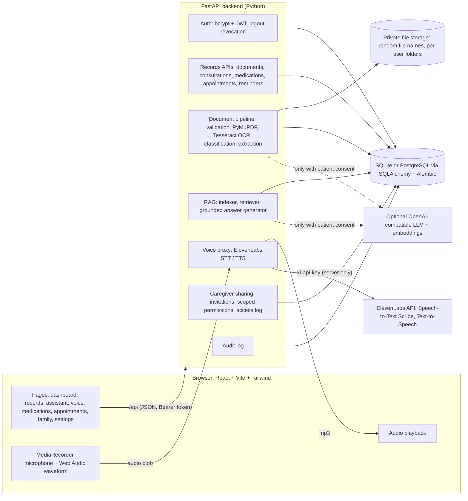
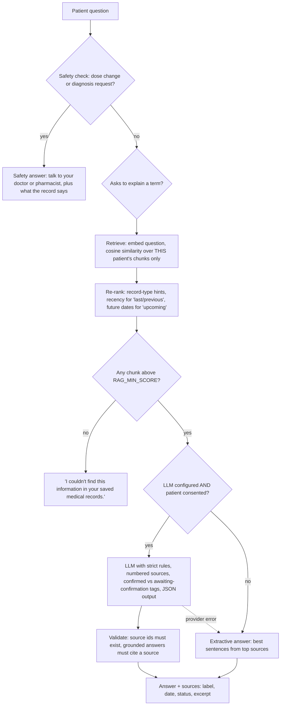
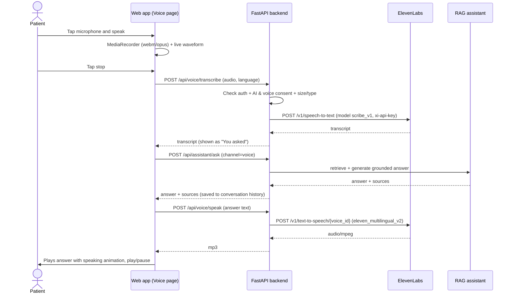

# MediMemory architecture

The diagrams use Mermaid. They render on GitHub, and in VS Code with the "Markdown Preview Mermaid Support" extension.

## 1. System architecture



Key points:

- The browser never sees API keys. ElevenLabs and LLM calls happen only in the backend.
- Every query is filtered by the authenticated user's id (`owner_id`). Caregiver access goes through separate `/api/caregiving/...` endpoints that check an active, scoped permission on every request.
- External AI and voice processing only happens when the patient has turned on **AI & voice processing** in Settings (`ai_data_consent`). Without it, the assistant answers by quoting the records, and embeddings are computed locally.

## 2. Database (ER diagram)

```mermaid
erDiagram
  USERS ||--|| PATIENT_PROFILES : has
  USERS ||--o{ REVOKED_TOKENS : "logs out"
  USERS ||--o{ MEDICAL_DOCUMENTS : owns
  MEDICAL_DOCUMENTS ||--o| DOCUMENT_EXTRACTIONS : "extracted into"
  USERS ||--o{ CONSULTATIONS : owns
  CONSULTATIONS ||--o{ DOCTOR_INSTRUCTIONS : contains
  CONSULTATIONS o|--o{ MEDICATIONS : prescribes
  CONSULTATIONS o|--o{ MEDICAL_DOCUMENTS : "attached to"
  USERS ||--o{ MEDICATIONS : owns
  MEDICATIONS ||--o{ MEDICATION_SCHEDULES : "scheduled at"
  MEDICATION_SCHEDULES ||--o{ REMINDERS : generates
  USERS ||--o{ APPOINTMENTS : owns
  APPOINTMENTS ||--o{ REMINDERS : generates
  USERS ||--o{ CAREGIVER_INVITATIONS : "sends (patient)"
  USERS ||--o{ CAREGIVER_PERMISSIONS : "grants / receives"
  USERS ||--o{ CAREGIVER_ACCESS_LOGS : "is viewed / views"
  USERS ||--o{ CONVERSATION_SESSIONS : owns
  CONVERSATION_SESSIONS ||--o{ CONVERSATION_MESSAGES : contains
  USERS ||--o{ DOCUMENT_CHUNKS : "indexed for"
  USERS ||--o{ AUDIT_LOGS : "acted"

  USERS { int id PK; string email UK; string password_hash; string full_name; bool is_demo }
  PATIENT_PROFILES { int id PK; int user_id FK; date date_of_birth; string preferred_language; bool ai_data_consent; bool large_text; string voice_id }
  MEDICAL_DOCUMENTS { int id PK; int owner_id FK; string doc_type; string stored_filename; string status; date document_date; int consultation_id FK }
  DOCUMENT_EXTRACTIONS { int id PK; int document_id FK; text raw_text; string method; string confidence; json structured; json confirmed_data }
  CONSULTATIONS { int id PK; int owner_id FK; string doctor_name; date consultation_date; text doctor_notes; date follow_up_date; string status; int source_document_id FK }
  DOCTOR_INSTRUCTIONS { int id PK; int consultation_id FK; text text; string status }
  MEDICATIONS { int id PK; int owner_id FK; int consultation_id FK; string name; string dosage; string frequency; bool is_active; string status }
  MEDICATION_SCHEDULES { int id PK; int medication_id FK; string time_of_day; string days_of_week }
  REMINDERS { int id PK; int owner_id FK; string kind; int schedule_id FK; int appointment_id FK; datetime due_at; string status }
  APPOINTMENTS { int id PK; int owner_id FK; string title; datetime scheduled_at; bool is_follow_up; string status }
  CAREGIVER_INVITATIONS { int id PK; int patient_id FK; string caregiver_email; string token UK; json permissions; bool consent_given; string status }
  CAREGIVER_PERMISSIONS { int id PK; int patient_id FK; int caregiver_id FK; string scope; datetime revoked_at }
  CAREGIVER_ACCESS_LOGS { int id PK; int patient_id FK; int caregiver_id FK; string scope; datetime created_at }
  CONVERSATION_SESSIONS { int id PK; int owner_id FK; string title; string channel }
  CONVERSATION_MESSAGES { int id PK; int session_id FK; string role; text content; string answer_type; json sources }
  DOCUMENT_CHUNKS { int id PK; int owner_id FK; string source_type; int source_id; string record_status; text content; json embedding }
  AUDIT_LOGS { int id PK; int user_id FK; string action; string resource_type; datetime created_at }
```

Migrations live in `backend/migrations` (Alembic). The initial migration was tested on SQLite and PostgreSQL 16.

## 3. RAG workflow



What gets indexed (`app/rag/indexer.py`): consultations (notes, instructions, linked medicines, tests, follow-up), medications (dose, frequency, times, instructions), appointments, and documents (confirmed or pending summary + raw text chunks). Each chunk stores `record_status` (`confirmed` or `pending_review`), so the assistant can say when something hasn't been confirmed yet.

Embeddings: `local` (default) is an offline hashed bag-of-words/bigram model with medical synonym normalisation. It is lexical rather than truly semantic. Set `EMBEDDING_PROVIDER=openai` for semantic embeddings; the index is rebuilt automatically when the model changes.

Answer types shown in the UI: **From your records** (grounded), **Not in your records**, **General explanation (not from your records)**, **Safety notice**.

## 4. Voice interaction workflow



Failure handling: missing key returns **503** with setup instructions (the UI shows a banner and keeps the typed fallback); invalid key returns **502**; quota or rate limits return **503**; network errors return **504**; an empty transcript returns **422** ("I couldn't hear any words…"). Microphone permission and device errors are handled in the browser.
